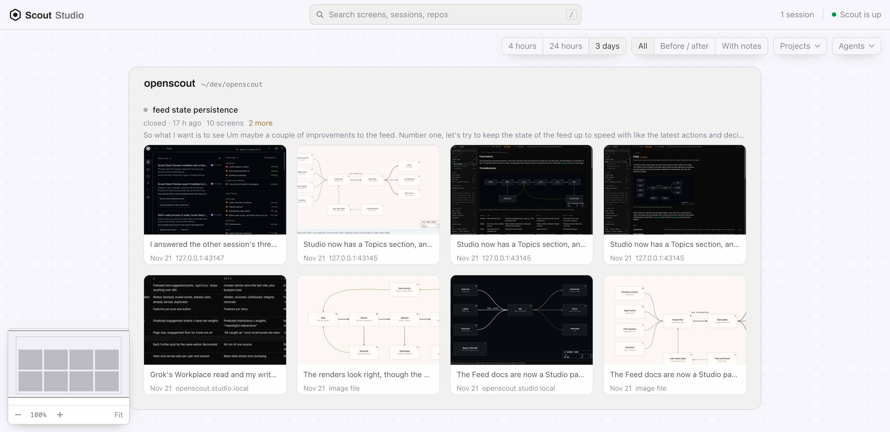

# Scout Studio

What your agents make, on Scout's canvas. Pin a note on a screen, and Scout takes it to the session that made the screen.

Each repository is a frame, each Claude Code session is an area, and the screens a session took are cards, newest first. Open a screen to see it full size. When the session took the same view earlier, a wipe lays the before over the after. Click or right-click anywhere on a screen to pin a note there. Scout delivers the note into that session, and the session's answer shows beside the note as a thread.

<picture>
  <source media="(prefers-color-scheme: dark)" srcset="docs/studio-dark.png">
  
</picture>

## Run it

```sh
npx github:openscout-app/studio
```

That's all. It fetches Scout Studio from this repository, builds it, and opens http://localhost:4801. Add `--no-open` to skip the browser, or `--port <n>` for another port. If Scout Studio is already running, the command opens it. If something else holds the port, it takes the next free one.

To send notes into your sessions, and to give agents the Scout Studio tools, set up once:

```sh
npx github:openscout-app/studio setup
```

Scout Studio depends on [Scout](https://github.com/openscout-app/scout) (`@openscout/scout`) and brings its CLI along. `setup` starts Scout's runtime if it isn't up (`scout setup`), then registers the tools with Claude Code (see [Let agents point you at a screen](#let-agents-point-you-at-a-screen)). Scout's runtime runs on [Bun](https://bun.sh) 1.4.4 or newer; if Bun is missing, `setup` says how to get it. A Scout you installed yourself is used first.

You need macOS, Node 20 or newer, and Claude Code. Without Scout's runtime, the canvas still shows every session and screen; notes are kept and wait until Scout is up.

From a clone:

```sh
git clone https://github.com/openscout-app/studio.git
cd studio
npm install
npm run build
npm start          # or `npm run dev` for hot reload
```

Studio uses:

- `sips`, which comes with macOS, to make card thumbnails.
- Scout's runtime at `127.0.0.1:43110`, for session titles and shown files (`SCOUT_RUNTIME_URL` changes it).
- The `scout` command, to send notes with `scout session send` (`SCOUT_BIN` changes it).

## Where screens come from

The canvas reads Claude Code transcripts in `~/.claude/projects` written in the chosen window: 4 hours, 24 hours or 3 days. It opens on the last 4 hours (or the window `?hours=24` or `?hours=72` in the address names) and looks further back on its own when that holds no screens; a link to an older session widens it as far as it needs, up to a week. A screen is any image of at least 320 by 200 that a tool returned: a browser screenshot, a window screenshot, or an image file the session read. Subagents' screens belong to the session that started them. The images are copied out of the transcripts into `~/.openscout/.studio/img`, so they outlive temporary files.

## Shown files, from Scout's runtime

When Scout's runtime answers on this host, Studio adds what agents chose to show you. An agent runs `scout show <file> --caption "…"` (or calls Scout's `show` tool), and the file appears first in its session's area, marked shown, within a second. Click it to read it: Markdown is drawn as a page, an HTML page runs in a sandbox of its own, and pictures, video, PDFs and text open as they are. Showing the same file again makes a new version, and Studio opens the latest.

Studio finds the runtime the way Scout's own tools do: `SCOUT_RUNTIME_URL` or `OPENSCOUT_BROKER_URL` if set, else the host and port in `~/.openscout/config.json`, else `127.0.0.1:43110`. It only reads from the runtime; notes still go to sessions through the `scout` command. With no runtime, Studio draws screens from transcripts as before, and the chip in the bar says Scout isn't running.

## Live, and quick to open

The page doesn't poll. It opens an event stream (`/api/events`), and the server pushes the canvas when something on it changes: a transcript grows (macOS file events on `~/.claude/projects`), the runtime shows a file (its `/v1/shows/events` stream), or the first read moves along. While agents write, pushes come at most about once a second. If the stream drops, the page polls until it reconnects.

Opening is immediate. The server keeps the last whole canvas for each window in `~/.openscout/.studio/canvas-<hours>h.json`. A server that has just started answers with that at once and corrects it as it reads the transcripts again; a session keeps its earlier copy until its transcript has been read to the end, so no card goes away and comes back. On the first run there is no snapshot yet, and the canvas fills in session by session as they are read.

## Before and after

A screen has a before only when it shows the same thing as an earlier screen in the same session:

| Screen | Same thing means |
| --- | --- |
| Browser screenshot | The same page address, without the query |
| Window screenshot | The same window |
| Image file | The same name in the same folder, less a trailing number or `before`/`after` |

The two must also have about the same shape. A screen with no address, window, or file name has no before.

## Notes

A note goes out at once when its session is open. A closed session's note waits, and Scout tries again every 20 seconds. **Hand to a new session** gives the note to a new Claude session in the same repository (`scout ask --project`). A send that Scout refuses is retried six times, then stops until **Retry**.

The message carries a marker (`[scout-studio:n_…]`). The canvas finds the marker in the session's transcript, which shows that the note arrived, and it shows what the session said after it.

Notes are kept in `~/.openscout/.studio/notes.json` (`SCOUT_STUDIO_HOME` moves the folder; with `OPENSCOUT_HOME` set, it is `$OPENSCOUT_HOME/.studio`). A host that still has `~/.scout-studio` or `~/.scout-canvas` from before keeps using it until the new folder exists. The server listens on 127.0.0.1 only and refuses requests from other sites, so no web page can send notes into your sessions.

## Let agents point you at a screen

An agent can show you one spot or area on a screenshot it took, with what it wants you to know about it. You get a short link. It opens that screen with the spot marked and the agent's words beside it. Your reply goes back to the session with the words it answers.

Set it up once:

```sh
npx github:openscout-app/studio setup
```

This gives every new Claude Code session three tools. The session already knows which session it is (Claude Code passes `CLAUDE_CODE_SESSION_ID` to its tools), so the agent never names one.

| Tool | What the agent gets |
| --- | --- |
| `screens` | Its recent screenshots, newest first: an id, the size in pixels, the page or file, and what it said around each. |
| `point` | A link such as `http://localhost:4801/p/p_f5e3a858fe`. The agent gives a screen id (or `latest`), a point `x, y` in pixels of the screenshot, or an area `x, y, w, h`, and `say`. |
| `pointers` | What it pointed at, whether you opened each, and your replies. |

If Scout Studio isn't running, the first tool call starts it in the background.

A pointer keeps its screen as it was. The link opens the same screen at the same spot, even after the session takes more screens or the canvas folds screens of the same page together. Pointers are kept in `~/.openscout/.studio/pointers.json`.

From a shell instead of a tool, an agent can run:

```sh
npx github:openscout-app/studio link --box 70,82,1000,80 --say "This header is the session you were on"
npx github:openscout-app/studio link --screen 7d89a329b6abd2ce --at 640,380 --say "…"
```

Coordinates are pixels of the screenshot. Add `--fraction` to give them as 0 to 1. `setup --print` shows the registration command instead of running it.

Scout Studio also remembers where you were. When you open it again, the session you were looking at sits where you left it.

### In the thread, as a plugin

The same three tools also come as a plugin, in `plugin/`. In an app that draws MCP Apps, such as T3 Code, `screens` shows the session's screens as cards under the call, and `point` shows the screen with the spot marked and a box to reply in. Other apps show the tool's text, as before.

| App | Install |
| --- | --- |
| Claude Code | `claude plugin marketplace add openscout-app/studio`, then `claude plugin install scout-studio@openscout-studio` |
| Codex | `codex plugin marketplace add openscout-app/studio`, then `codex plugin add scout-studio@openscout-studio` |
| T3 Code | Runs Claude Code, so install it for Claude Code. |
| Capy | Add `https://github.com/openscout-app/studio/tree/main/plugin` as a plugin. |

The plugin and `setup` register the same server. Keep one: after you install the plugin, run `claude mcp remove scout-studio --scope user`.

The tools read Claude Code transcripts on this host. In a Codex thread or on a Capy cloud machine they load, but they find no session.

## Checks

```sh
npm test           # pairing, image sizes, prompt cleanup
npx tsc --noEmit
```

## License

Apache-2.0, as Scout is. See [LICENSE](LICENSE).
